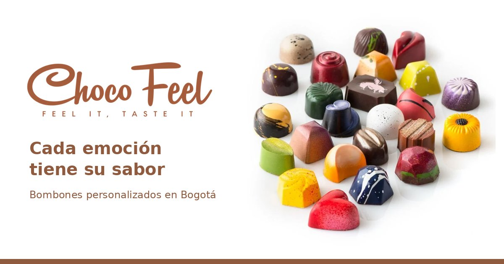

# ChocoFeel

**Cada emoción tiene su sabor.** ChocoFeel es una tienda en línea de bombones de chocolate artesanales, pintados a mano con colorantes comestibles, que relaciona cada emoción con un sabor. El cliente puede comprar bombones del catálogo o armar su propia caja eligiendo forma, relleno y decoración.

Proyecto académico de emprendimiento con página web (Bogotá, Colombia).

🔗 **Página publicada:** https://thebrinks.github.io/ChocoFeel/



## Funciones

| Sección | Qué hace |
|---|---|
| **Inicio** | Banner, carrusel de destacados, pestañas de productos, novedades y newsletter. |
| **Tienda** | Los 22 bombones del catálogo con filtro por emoción (alegría, calma, amor, nostalgia, energía), búsqueda sin importar tildes y orden por precio o nombre. |
| **Personaliza** | Armador de cajas en 7 pasos: emoción (sugiere relleno y colores), forma, tipo de chocolate, relleno, decoración, tamaño de caja (4, 6, 9 o 12) y mensaje para la tarjeta. Calcula el precio y el peso al instante. |
| **Detalle** | Página de cada producto con precio, emociones, decoración, cantidad y productos relacionados. |
| **Carrito y compra** | Cambiar cantidades, eliminar productos, ver el total y finalizar la compra con datos de entrega y método de pago. |
| **Cuenta** | Registro, inicio de sesión, pedidos realizados y datos guardados que se llenan solos al comprar. |
| **Favoritos** | Guardar productos con el corazón de cada tarjeta. |
| **Información** | Sobre nosotros, envíos, política de privacidad, contacto y centro de ayuda. |

Además:
- **Responsive:** se adapta a computador, tableta y celular (menú de hamburguesa desde 992 px).
- **Accesible:** 0 problemas en la auditoría automática con [axe-core](https://github.com/dequelabs/axe-core) (WCAG 2.1 AA): textos alternativos, contraste de color, navegación con teclado y orden de títulos.
- **Liviana:** imágenes en formato WebP (unos 600 px de ancho).

## Precios

Los precios siguen las mismas reglas en el catálogo y en el armador:

- **Precio base por bombón:** $4.000 COP (todas las formas y tipos de chocolate).
- **Recargo por relleno:** maní, flan, brownie, avellana y caramelo salado +$1.000; vino +$1.500; los demás sin recargo.
- **Recargo por decoración:** un color +$500; degradado o salpicado +$1.000; diseño especial (mármol, galaxia) +$2.000.
- **Tamaño aproximado:** 3 cm de ancho y 12 g por bombón.

Como referencia, bombones artesanales de tiendas colombianas costaban entre unos $3.250 y $7.830 COP por unidad al momento de crear el proyecto.

## Tecnologías

- HTML, CSS y JavaScript, sin frameworks.
- [Swiper 9](https://swiperjs.com/) para los carruseles.
- [UIcons de Flaticon](https://www.flaticon.es/uicons) para los íconos.
- Fuentes [Nunito Sans](https://fonts.google.com/specimen/Nunito+Sans) y [Playfair Display](https://fonts.google.com/specimen/Playfair+Display) de Google Fonts.
- Publicada con GitHub Pages desde la rama `main`.

## Estructura

```
├── index.html            Inicio
├── shop.html             Tienda
├── customize.html        Armador de cajas personalizadas
├── details.html          Detalle de un producto (details.html?id=...)
├── cart.html, checkout.html, wishlist.html
├── accounts.html, login-register.html
├── about.html, contact.html, help.html, privacy.html, shipping.html
├── 404.html              Página de error de GitHub Pages
└── assets/
    ├── css/styles.css    Estilos (variables de color en :root, clases estilo BEM)
    ├── img/              Imágenes
    └── js/
        ├── products.js   DATOS: productos, secciones, opciones del armador y emociones
        ├── main.js       Código compartido: tarjetas, menú, carrito, favoritos, sesión
        └── *.js          Un archivo por página (shop.js, customize.js, cart.js...)
```

Para agregar o cambiar un producto, solo hay que editar `assets/js/products.js`.

## Cómo verla en tu computador

1. Clona este repositorio.
2. Abre `index.html` en el navegador (o usa la extensión *Live Server* de VS Code).

La página `404.html` solo se ve bien publicada en GitHub Pages, porque usa rutas que empiezan en `/ChocoFeel/`.

## Limitaciones (no hay servidor)

Esta versión es una demostración que funciona sin servidor ni base de datos:

- La sesión, el carrito, los favoritos y los pedidos se guardan en el navegador de cada persona (`localStorage`). No se comparten entre dispositivos.
- El inicio de sesión no comprueba contraseñas y nunca las guarda.
- La newsletter no guarda los correos.
- Los pagos son simulados: no se piden datos de tarjeta ni se cobra nada.
- El formulario de contacto abre la aplicación de correo de quien lo usa.

Para funcionar como tienda real se necesitaría un servidor con base de datos y una pasarela de pagos.

## Créditos

- Imágenes de productos tomadas de internet (principalmente Pinterest) como **referencia con fines académicos**.
- Íconos: [UIcons de Flaticon](https://www.flaticon.es/uicons).

## Equipo

- **Juan Pablo Fuquen Martinez** — Desarrollo web
- **Miguel Angel Rivas Ochoa** — Diseño web y marketing
